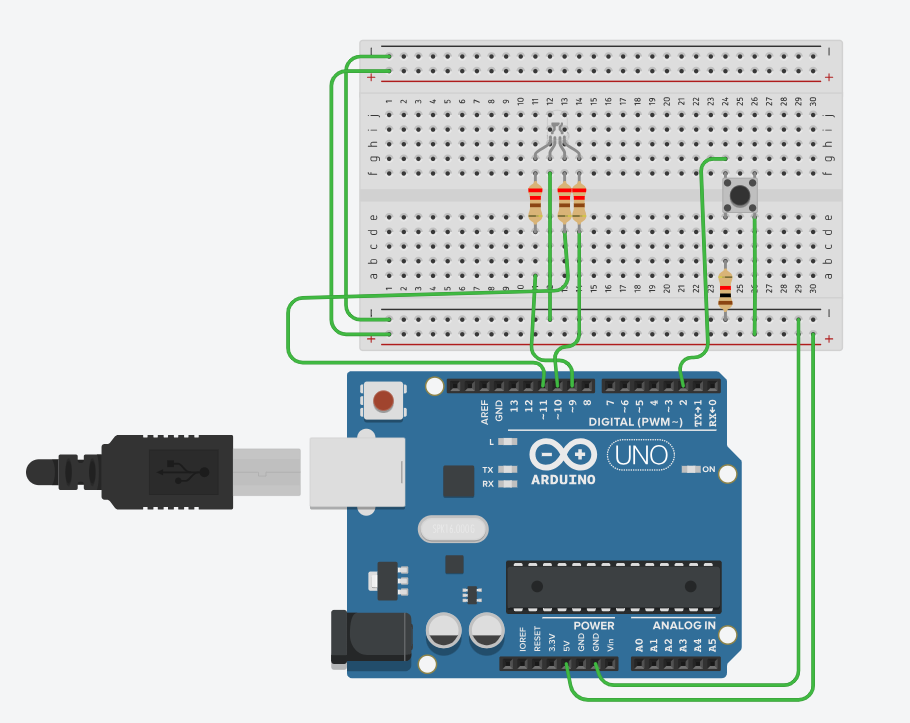

# Push Button Control of an RGB LED

## 1. Project Overview

This project demonstrates the control of an RGB LED using a push button and Arduino UNO R3.

The system detects different button-press patterns and controls the RGB LED accordingly. It uses the `millis()` function for time-based operations without blocking program execution using `delay()`.

## 2. Objectives

- Interface a push button with Arduino UNO.
- Control an RGB LED using different button-press patterns.
- Implement single press, double press and long press detection.
- Understand button debouncing techniques.
- Implement non-blocking timing using `millis()`.

## 3. Hardware Components Required

| S.No | Component | Quantity |
|---|---|---|
| 1 | Arduino UNO R3 | 1 |
| 2 | RGB LED (Common Cathode) | 1 |
| 3 | Push Button | 1 |
| 4 | Resistors for RGB LED | 3 |
| 5 | 10kΩ Resistor (Pull-down) | 1 |
| 6 | Breadboard | 1 |
| 7 | Jumper Wires | As required |

## 4. Pin Configuration

| Component | Arduino Pin |
|---|---|
| Push Button | D2 |
| Red LED | D9 |
| Green LED | D10 |
| Blue LED | D11 |

## 5. Working Principle

The project identifies three different button operations.

| Button Operation | LED Output |
|---|---|
| Single Press | Red LED ON |
| Double Press | Green LED ON |
| Long Press (2 Seconds) | Blue LED ON |

### Single Press
When the push button is pressed and released once, the system waits for the double-press detection interval. If no second press occurs within 350 milliseconds, the Red LED turns ON.

### Double Press
When the push button is pressed twice within 350 milliseconds, the Green LED turns ON.

### Long Press
When the push button is held continuously for more than 2 seconds, the Blue LED turns ON.

## 6. Software and Tools

- Arduino IDE
- Tinkercad Circuits
- Embedded C / Arduino Programming

## 7. Programming Concepts Used

- Digital Input and Output
- `digitalRead()` and `digitalWrite()`
- `pinMode()`
- `millis()` function
- Button Debouncing
- Conditional Statements
- State-based Button Detection
- Non-blocking Programming

## 8. Circuit Diagram

## 9. Key Features

- Three different button operations.
- RGB LED color control.
- Software-based button debouncing.
- Non-blocking execution using `millis()`.
- No `delay()` function used.

## 10. Applications

- Button-based control systems.
- Embedded systems learning.
- User interface development.
- Digital input processing.

## 11. Future Improvements

- Add multiple push buttons.
- Implement brightness control using PWM.
- Add additional LED patterns.
- Interface an OLED display to show the detected button operation.

## 12. Author

**Hemanth**

## 13. Project Platform

Designed and simulated using **Tinkercad Circuits**.

---

*This project is developed for learning Arduino programming, digital input handling and embedded systems concepts.*
