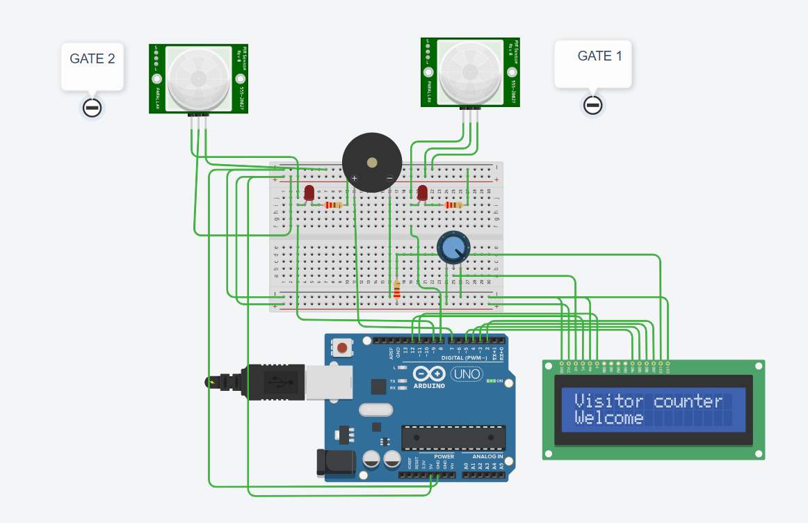

# Bidirectional Visitor Counter Using PIR Sensors

**A Bare-Metal Embedded C Project using Arduino Uno (ATmega328P)**

## 1. Project Overview

The **Bidirectional Visitor Counter Using PIR Sensors** is an embedded systems project developed using an Arduino Uno based on the ATmega328P microcontroller.

The system uses two PIR (Passive Infrared) motion sensors positioned at two gates to detect people entering and exiting a room. By identifying the sequence in which the sensors are activated, the system determines the direction of movement and automatically updates the visitor count.

The project is implemented using **Bare-Metal C Programming**, directly accessing ATmega328P hardware registers such as `DDRx`, `PORTx`, and `PINx` instead of relying on high-level Arduino GPIO functions.

A 16×2 LCD displays the visitor count and detection status, while a piezo buzzer provides an audible indication after a confirmed entry or exit.

## 2. Project Features

- Bidirectional visitor detection using two PIR sensors.
- Entry detection using Gate 1 → Gate 2 sequence.
- Exit detection using Gate 2 → Gate 1 sequence.
- Automatic visitor count increment and decrement.
- Prevents the visitor count from becoming negative.
- Timeout handling for incomplete crossing sequences.
- Rising-edge detection to prevent repeated counting while a PIR output remains HIGH.
- 16×2 LCD for displaying visitor count and system status.
- Buzzer indication after confirmed entry or exit.
- Direct hardware register programming using Bare-Metal C.

## 3. Circuit Diagram

The following circuit was designed and simulated using Tinkercad Circuits.



## 4. Hardware Components

| Component | Quantity |
|---|---:|
| Arduino Uno (ATmega328P) | 1 |
| PIR Motion Sensors | 2 |
| 16×2 LCD Display | 1 |
| Piezo Buzzer | 1 |
| Potentiometer | 1 |
| Breadboard | 1 |
| Jumper Wires | As required |

## 5. Pin Configuration

### PIR Sensors and Buzzer

| Component | Arduino Pin | ATmega328P Pin |
|---|---|---|
| PIR Sensor 1 (Gate 1) | D8 | PB0 |
| PIR Sensor 2 (Gate 2) | D9 | PB1 |
| Piezo Buzzer | D7 | PD7 |

### LCD Display (4-bit Mode)

| LCD Pin | Arduino Pin | ATmega328P Pin |
|---|---|---|
| RS | D12 | PB4 |
| Enable (E) | D11 | PB3 |
| D4 | D5 | PD5 |
| D5 | D4 | PD4 |
| D6 | D3 | PD3 |
| D7 | D2 | PD2 |
| RW | GND | — |
| VSS | GND | — |
| VDD | 5V | — |
| V0 | Potentiometer | — |

## 6. Working Principle

The system determines the direction of movement based on the order of activation of the two PIR sensors.

### A. Entry Detection (Gate 1 → Gate 2)

1. Gate 1 (PIR Sensor 1) detects motion first.
2. The system enters the `ENTRY_PENDING` state.
3. The LCD displays "Gate 1 detected" and "Waiting Gate 2".
4. Gate 2 (PIR Sensor 2) detects motion.
5. Entry is confirmed and the visitor count increases by one.
6. The buzzer produces an audible indication.
7. The LCD displays the updated visitor count.

### B. Exit Detection (Gate 2 → Gate 1)

1. Gate 2 (PIR Sensor 2) detects motion first.
2. The system enters the `EXIT_PENDING` state, provided the visitor count is greater than zero.
3. The LCD displays "Gate 2 detected" and "Waiting Gate 1".
4. Gate 1 (PIR Sensor 1) detects motion.
5. Exit is confirmed and the visitor count decreases by one.
6. The buzzer produces an audible indication.
7. The LCD displays the updated visitor count.

### C. Incomplete Crossing

- If only one sensor is activated, the visitor count is not immediately changed.
- The system waits for the second sensor.
- If the second sensor does not activate within the configured timeout, the pending detection is cancelled.
- The visitor count remains unchanged.

### D. Zero Visitor Protection

When the visitor count is zero, an exit operation cannot decrease the count further.

The system displays:

```text
No more visitors
Count remains 0
```

## 7. Program Logic and State Management

The project uses three states to manage visitor movement.

| State Variable | Value | Description |
|---|---:|---|
| IDLE | 0 | Waiting for sensor activation |
| ENTRY_PENDING | 1 | Gate 1 detected; waiting for Gate 2 |
| EXIT_PENDING | 2 | Gate 2 detected; waiting for Gate 1 |

### Detection Sequence

```text
             SYSTEM START
                  |
                  v
                 IDLE
                  |
          +-------+-------+
          |               |
       Gate 1           Gate 2
          |               |
          v               v
   ENTRY_PENDING     EXIT_PENDING
          |               |
      Gate 2          Gate 1
          |               |
          v               v
    ENTRY CONFIRMED   EXIT CONFIRMED
          |               |
      Count +1         Count -1
          |               |
          +-------+-------+
                  |
                  v
                 IDLE
```

An incomplete crossing is cancelled when the configured timeout condition is reached.

## 8. Bare-Metal Programming Concepts

This project demonstrates direct hardware-level programming of the ATmega328P microcontroller.

### DDRx Register
Used to configure microcontroller pins as input or output.

### PORTx Register
Used to control digital output pins and enable internal pull-up resistors.

### PINx Register
Used to read the current logic state of input pins.

### Bitwise Operators
Used to set, clear, and check individual hardware register bits.

### User-Defined Functions
The program is organized into functions for GPIO initialization, LCD interfacing, buzzer operation, and visitor counting.

### State Machine
Three states (`IDLE`, `ENTRY_PENDING`, and `EXIT_PENDING`) are used to identify the direction of visitor movement.

### Software Delay
The `_delay_ms()` function is used to generate software delays for LCD communication, buzzer operation, and the main program loop.

## 9. Software and Development Tools

| Tool / Technology | Purpose |
|---|---|
| Tinkercad Circuits | Circuit design and simulation |
| Arduino Uno | Microcontroller platform |
| ATmega328P | Microcontroller architecture |
| Embedded C | Programming language |
| AVR-GCC | AVR C compiler |
| AVR I/O Library | Hardware register access |
| AVR Delay Library | Software delay generation |
| GitHub | Source code and project documentation |

## 10. Expected Results

| Sensor Sequence | Expected Result |
|---|---|
| Gate 1 → Gate 2 | Entry confirmed; count increases by 1 |
| Gate 2 → Gate 1 | Exit confirmed; count decreases by 1 |
| Gate 1 only | No count change |
| Gate 2 only | No count change |
| Incomplete crossing | Pending detection cancelled after timeout |
| Exit when count = 0 | Count remains 0 |

## 11. Applications

- Classroom occupancy monitoring.
- Laboratory visitor counting.
- Small office occupancy monitoring.
- Room entry and exit monitoring.
- Basic people-counting systems.

## 12. Learning Outcomes

Through this project, I gained practical experience in:

- Understanding ATmega328P microcontroller architecture.
- Programming GPIO pins using hardware registers.
- Interfacing PIR sensors with a microcontroller.
- Interfacing a 16×2 LCD in 4-bit mode.
- Implementing bidirectional visitor detection logic.
- Using bitwise operators for register manipulation.
- Developing embedded applications using Bare-Metal C.
- Implementing state-based control logic.

## 13. Project Limitations

- PIR sensors detect motion rather than identifying individual people.
- Multiple people crossing simultaneously may result in inaccurate counting.
- Sensor response and detection delays can affect the accuracy of direction detection.
- The visitor count is stored in RAM and resets when the microcontroller restarts.
- The software timeout is approximate because the program uses blocking delays.

## 14. Future Improvements

- Implement non-blocking timing using a hardware timer.
- Add EEPROM storage to retain the visitor count after power loss.
- Improve detection reliability for multiple people.
- Add wireless monitoring using ESP8266 or ESP32.
- Develop a web-based dashboard for real-time occupancy monitoring.

## 15. Project Information

| Detail | Description |
|---|---|
| Project Name | Bidirectional Visitor Counter Using PIR Sensors |
| Domain | Embedded Systems |
| Microcontroller | ATmega328P |
| Development Board | Arduino Uno |
| Programming Language | Bare-Metal C |
| Simulation Platform | Tinkercad Circuits |
| Interface | 16×2 LCD |
| Sensors | PIR Motion Sensors |

---
